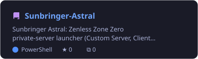
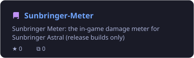
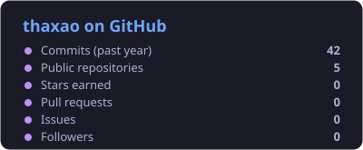
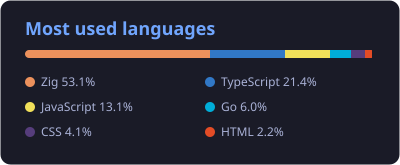

<table>
<tr>
<td width="55%" valign="top">

### About me

- Computer Science student building **private-server and launcher tooling** for games
- Day-to-day work: **Zig** servers, protocol work, client patching on **Linux**
- Interested in **systems programming**, **reverse engineering** and **developer tools**
- Learning by shipping: every project here is something I actually use

</td>
<td width="45%" valign="top">

### Tech stack

 

</td>
</tr>
</table>

### Featured projects

  
  

### GitHub at a glance

  
  

